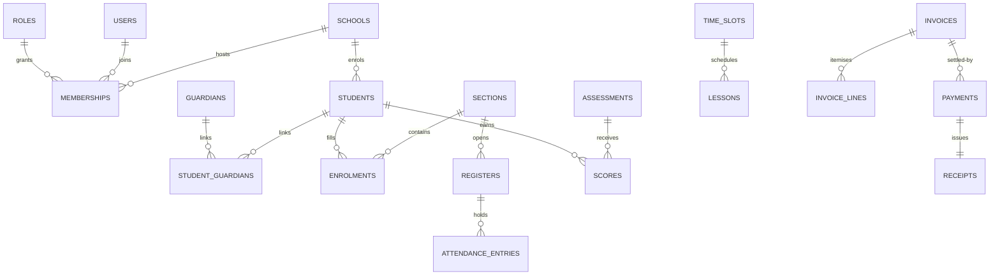

# Task 5: Data Model and Architecture

School management platform covering **Admissions, Attendance, Grades,
Timetable, Fees, and Communication**, with explicit data-model,
relationship, auth, and multi-school tenancy design.

This document is the authoritative design record for Task 5. Each section
maps to its acceptance criterion (`c1`–`c4`), and `c3` additionally carries
the Task 5 focus areas: **entities, relationships, auth, multi-school
support**.

## Traceability (criteria coverage)

| Criterion | Statement | Section |
|---|---|---|
| c1 | Scope and user roles defined | `c1-a` scope, `c1-b` user roles |
| c2 | Core modules and MVP prioritized | `c2` modules + MVP |
| c3 | Architecture and tech stack selected | `c3` architecture, tenancy, auth, data model, tech stack |
| c4 | Delivery milestones approved | `c4` milestones + approval |

---

## c1-a: Scope

### Problem and goal

Schools run admissions, attendance, grades, timetables, fees, and parent
communication on disconnected spreadsheets, paper, and chat apps. The goal
is one backend-driven system of record with role-based access and a
multi-school-ready data model, so every stakeholder works from the same
school, student, class, and term data.

### In scope (platform)

- Student lifecycle: enquiry → application → admission → enrolment →
  class assignment → graduation/transfer, all keyed to a school tenant.
- Daily school operations: attendance marking, grade entry, timetable
  publishing, fee invoicing/collection, and official communication.
- Multi-school support: one deployment hosts many schools with strict
  per-school data isolation (shared database, `school_id` discriminator,
  row-level enforcement).
- Cross-cutting: authentication, role-based authorization, academic
  sessions/terms, audit trail, reporting exports (CSV/PDF).
- Data model deliverable: entity catalogue, relationships with
  cardinalities and delete rules, integrity constraints, and reference
  DDL in `db/schema.sql`.

### Out of scope for MVP (explicit non-goals)

- Payroll/HR, inventory, transport GPS tracking, library management
  (Phase 2+ modules, must not break the core model).
- Online examinations/CBT and e-learning content delivery.
- Native mobile apps (MVP is responsive web + API; native later).
- Per-school billing/metering of the SaaS platform itself (tenancy
  isolation ships in MVP; monetization is later).
- Payment gateway settlement beyond recording provider references
  (online payment links in Phase 2).

### Assumptions and constraints

- One active academic session per school with multiple terms; historical
  sessions are read-mostly and never mutated except by correction flow.
- Each school defines its own grading scale, fee structure, and
  timetable slots per term (all configurable, no hard-coding).
- One timezone per school; timestamps stored as UTC (`timestamptz`).
- Offline-first clients are out of scope; attendance entry tolerates
  brief outages via retry, not full offline sync.
- MVP scale target: up to ~50 schools per deployment, ~2,000 students
  and ~200 staff per school.

---

## c1-b: User roles

| Role | Primary responsibilities | Modules used |
|------|--------------------------|--------------|
| System Administrator | Tenants, users, roles, school setup, audit logs, backups | All (config; only cross-school role) |
| Principal / Head of School | Approvals, dashboards, reports, announcements (own school) | All (read + approve, school-scoped) |
| Registrar / Admissions Officer | Enquiries, applications, admissions, enrolment | Admissions, Communication |
| Teacher | Mark attendance, enter grades, view timetable | Attendance, Grades, Timetable, Communication |
| Class Teacher / Form Tutor | Own class attendance, comments, parent contact | Attendance, Grades, Communication |
| Accountant / Bursar | Fee structures, invoices, receipts, arrears | Fees, Communication |
| Student | View timetable, grades, fees owed, messages | Timetable, Grades, Fees (read), Communication |
| Parent / Guardian | View ward's attendance, grades, fees; pay; message | Attendance, Grades, Fees, Communication (scoped to wards) |
| IT Support | User provisioning help, read-only diagnostics (school-scoped) | All (limited) |

Guardian is a contact/account linked to one or more students via
`student_guardians`; a Parent is a user account attached to a guardian
profile. Students and parents never see other families' rows.

### Permission rules

- Every API action is authorized by `(role, module, action)` plus a
  tenant check (`resource.school_id == request.school_id`); deny by
  default.
- Cross-school reads are denied for every role except System
  Administrator, and even admins mutate one school per request.
- Students see only their own records; parents/guardians see only their
  linked wards' records.
- Teachers see only assigned classes/subjects unless granted
  class-teacher scope for a section.
- Fee adjustments, discounts, and refunds require the Accountant role
  plus Principal approval above a configurable threshold; every money
  mutation writes an audit entry with actor and timestamp.
- Grade publishing is two-step: Teacher enters draft → Principal (or
  delegate) publishes; published grades are immutable except by
  correction workflow with audit entry.
- Admissions decisions (offer/waitlist/reject) require Registrar action
  plus Principal approval for offers.

---

## c2: Core modules and MVP prioritization

Prioritization uses MoSCoW per feature: **M**ust (MVP), **S**hould
(Phase 2), **C**ould (later), **W**on't (out of scope). MVP ships the
Must slice of every module so the six modules integrate end to end.

### Module 1: Admissions (priority P0)

Purpose: convert enquiries into enrolled students.

- M: Enquiry capture; application form with documents; application
  review queue; offer / waitlist / reject decision with approval;
  acceptance and enrolment into class/session; unique per-school
  student ID.
- S: Online application portal for parents; bulk import; waitlist
  auto-promotion.
- C: Entrance-exam scheduling and scoring inside Admissions.

MVP acceptance: an application can move from submitted → offered →
accepted → enrolled, and the enrolled student appears in Attendance,
Grades, Timetable, and Fees without re-entry.

### Module 2: Attendance (priority P0)

Purpose: daily truth of who is present.

- M: Class/session register per day; present/absent/late/excused codes;
  class-teacher marking with same-day edit window; per-student and
  per-class summaries; term attendance percentage.
- S: Biometric/RFID import; parent absence notifications; truancy
  alerts.
- C: Timetable-period-level attendance (MVP is daily + optional period).

MVP acceptance: a class register closes daily; summary feeds report
cards and parent views.

### Module 3: Grades (priority P0)

Purpose: record, compute, and publish student performance.

- M: Assessment setup per subject (CA/exam weights); score entry with
  validation; automatic totals/grades per school scale; draft →
  published workflow; term report card data; class broadsheet.
- S: Grade analytics and trends; parent SMS/push on publish.
- C: Custom transcript templates per school.

MVP acceptance: scores entered once compute totals correctly per the
configured scale, and only published grades are visible to
students/parents.

### Module 4: Timetable (priority P1)

Purpose: schedule classes, teachers, and rooms without clashes.

- M: Terms, days, and period slots; class-subject-teacher-room
  assignments; clash detection (teacher/room/class double-booking);
  published class and teacher timetables.
- S: Auto-generation suggestions; substitute-teacher handling; room
  utilization reports.
- C: Parent-visible exam timetable with seat allocation.

MVP acceptance: publishing a timetable with a clash is rejected with
the conflicting entries named; every student/teacher sees their own
weekly view.

### Module 5: Fees (priority P0)

Purpose: bill accurately and collect traceably.

- M: Fee structures per class/term; per-student invoices; payments with
  receipts; partial payments and arrears aging; discounts/waivers with
  approval; daily collection report.
- S: Online payment links with provider reconciliation; dunning
  reminders; multi-currency.
- C: Instalment plans engine.

MVP acceptance: invoice → payment → receipt balances to zero or shows
correct arrears; every money mutation has an audit entry with actor
and timestamp.

### Module 6: Communication (priority P1)

Purpose: official channel between school, parents, and students.

- M: Announcements (school/class scoped); direct messages
  teacher ↔ parent; message templates for fees/grades/admissions
  events; notification log; opt-out-safe record of what was sent.
- S: SMS/email/push provider integration; scheduled messages.
- C: In-app chat, forums.

MVP acceptance: admissions offers, published grades, and fee invoices
each trigger the correct template to the correct audience, logged.

### MVP definition (the shippable slice)

MVP = all **Must** features above, integrated: one student record flows
from Admissions into Attendance, Grades, Timetable, Fees, and
Communication with role-based access and per-school isolation. No module
ships standalone.

### Build order (dependency-driven)

1. Foundation: multi-tenant core (`schools`, sessions/terms), auth/RBAC,
   audit, API skeleton (all modules depend on this).
2. Admissions → student record (feeds everything).
3. Timetable skeleton (classes/subjects needed by Attendance/Grades).
4. Attendance + Grades (parallel, share class/subject data).
5. Fees (needs enrolled students; invoices reference terms).
6. Communication (wires events from 2–5 last).

---

## c3: Architecture and tech stack

### Architecture overview

- **Modular monolith, API-first.** One deployable backend with strict
  module boundaries matching the six modules above plus `identity`
  (auth/RBAC), `core` (school/session/term), and `shared` (audit,
  notifications, file storage). Modules communicate through service
  interfaces, never direct table access across modules.
- **Clients:** responsive web app (MVP) consuming a versioned REST API
  (`/api/v1/...`); the same API serves future mobile apps.
- **Data:** relational database as system of record; per-module tables
  with foreign keys into `core` (schools, students, classes, terms). No
  cross-module joins in application code outside reporting views.
- **Background jobs:** queued workers for notifications, report
  generation, and fee reminders (no long work in request handlers).
- **Files:** object storage for documents/uploads (admissions docs,
  receipts, exports); only metadata in the database.
- **Why not microservices for MVP:** six modules with shared student
  data do not justify distributed-transaction overhead; module
  boundaries keep the extraction path open later.

```text
Browser / PWA --> Web app --> REST API /api/v1 (auth, tenant guard, RBAC, validation)
                                                     |
              +----------+---------+--------+--------+--------+--------+----------+
              |          |         |        |        |        |        |          |
           identity    core   admissions attendance grades timetable fees  communication
              |          |         |        |        |        |        |          |
              +------------------------+---+--------------------+--------------+
                                       |
                        PostgreSQL (school_id on every tenant row + RLS)
                        Redis (sessions, cache, job queue)
                        S3-compatible storage (documents, exports)
                        Email/SMS/push providers (queued workers)
```

### Multi-school support (tenancy design)

Tenancy model: **shared database, shared schema, discriminator column**.

- Every tenant-owned table carries `school_id UUID NOT NULL REFERENCES
  schools(id)`. Global tables (`schools`, `roles`, `users`) do not.
- Row-Level Security (RLS) enforces isolation in PostgreSQL: each
  session sets `app.current_school_id`, and policies require
  `school_id = current_setting('app.current_school_id')::uuid`.
  Application middleware sets the value from the authenticated
  membership and also filters by `school_id` in every query (defence
  in depth: an app bug still hits the RLS policy).
- Membership: `users` are global (one login across schools); access is
  granted per school via `user_school_memberships(user_id, school_id,
  role_id)`. A teacher working at two schools has two membership rows
  and picks an active school per session; tokens embed `(user_id,
  school_id, role)` and are rejected if the membership is revoked.
- Uniqueness is per school, not global: e.g.
  `UNIQUE (school_id, admission_no)`, `UNIQUE (school_id, code)` on
  classes, `UNIQUE (school_id, invoice_no)`. Lookup indexes always lead
  with `school_id`.
- Sequences/codes (admission numbers, invoice numbers) are per-school
  series so one school's numbering never leaks into another's.
- Files are namespaced by `school_id` prefix in object storage.
- Backups/restore and exports are school-scoped: per-school export job
  dumps only rows matching the tenant; restore targets one school.
- Rejected alternative: schema-per-school. It complicates migrations
  (N schema upgrades), cross-school admin reporting, and connection
  pooling for little MVP benefit. The `school_id` + RLS design keeps a
  clean extraction path: if a large school later needs physical
  isolation, its rows filter cleanly by `school_id` for migration.
- Reference implementation: `db/schema.sql` (tables, foreign keys,
  per-school unique constraints, indexes, and RLS policies).

### Auth design

- **Credentials:** passwords hashed with argon2id (bcrypt fallback);
  strength rules + breach-list check; TOTP/OTP for resets and optional
  staff 2FA.
- **Tokens:** short-lived JWT access tokens (15 min) + rotating refresh
  tokens (stored hashed, single-use, revoked on reuse). Access claims:
  `sub, school_id, role, membership_id, session_id`. Every request
  re-validates membership status.
- **Tenant guard:** `TenantGuard` runs before RBAC: resolves the active
  `school_id` from the token, confirms an active membership row, sets
  the DB session variable, and rejects cross-tenant resource ids.
- **RBAC:** permission matrix `(role, module, action)` enforced by a
  per-module guard at the API layer; deny by default. Object-level
  checks (own record / ward's record / assigned class) run in services.
- **Sessions:** server-side session record per login (device, IP,
  revoked flag) so password change or role revocation kills sessions.
- **OIDC-ready:** identity module abstracts the credential check behind
  an `AuthProvider` interface; school SSO (Google/Entra) can be added
  without touching module code.
- **Rate limits & audit:** strict rate limits on login/OTP endpoints;
  all auth events (login, logout, refresh reuse, lockout) plus every
  mutation of student, grade, and money data land in `audit_log`.

### Data model: entities

Entity catalogue (authoritative list; physical DDL in `db/schema.sql`).
`Tenant` = carries `school_id`; `Global` = shared across schools.

| # | Entity (table) | Scope | Key attributes | Module |
|---|---|---|---|---|
| E1 | `schools` | Global | `code` unique, name, timezone, status | core |
| E2 | `users` | Global | email unique, password_hash, status | identity |
| E3 | `roles` | Global | name unique (admin, principal, registrar, teacher, accountant, student, parent, support) | identity |
| E4 | `user_school_memberships` | Tenant link | `user_id, school_id, role_id`, status | identity/core |
| E5 | `academic_sessions` | Tenant | year label, starts_on, ends_on, is_active | core |
| E6 | `terms` | Tenant | session_id, name, starts_on, ends_on | core |
| E7 | `classes` | Tenant | code, name, level | core |
| E8 | `sections` | Tenant | class_id, session_id, name, class_teacher_id | core |
| E9 | `subjects` | Tenant | code, name | core |
| E10 | `students` | Tenant | admission_no, first/last name, dob, gender, status | core |
| E11 | `guardians` | Tenant | name, phone, email, address | core |
| E12 | `student_guardians` | Tenant | student_id, guardian_id, relation, is_primary | core |
| E13 | `enrolments` | Tenant | student_id, section_id, session_id, roll_no | admissions |
| E14 | `enquiries` | Tenant | child name, contact, class applied, source, status | admissions |
| E15 | `applications` | Tenant | enquiry_id, submitted payload, status | admissions |
| E16 | `application_documents` | Tenant | application_id, file_key, doc_type | admissions |
| E17 | `admission_decisions` | Tenant | application_id, decision, decided_by, approved_by | admissions |
| E18 | `attendance_registers` | Tenant | section_id, date, status (open/closed) | attendance |
| E19 | `attendance_entries` | Tenant | register_id, student_id, code (present/absent/late/excused) | attendance |
| E20 | `assessments` | Tenant | subject_id, section_id, term_id, name, weight, max_score | grades |
| E21 | `scores` | Tenant | assessment_id, student_id, raw_score, status (draft/published) | grades |
| E22 | `grade_scales` | Tenant | label, min_score, max_score, grade, points | grades |
| E23 | `report_cards` | Tenant | student_id, term_id, payload JSONB, published_at | grades |
| E24 | `time_slots` | Tenant | term_id, day_of_week, starts_at, ends_at | timetable |
| E25 | `lessons` | Tenant | section_id, subject_id, teacher_id, room, slot_id | timetable |
| E26 | `fee_structures` | Tenant | class_id, term_id, head, amount, currency | fees |
| E27 | `invoices` | Tenant | student_id, term_id, invoice_no, total, status | fees |
| E28 | `invoice_lines` | Tenant | invoice_id, head, amount | fees |
| E29 | `payments` | Tenant | invoice_id, amount, method, provider_ref, received_by | fees |
| E30 | `receipts` | Tenant | payment_id, receipt_no, issued_at | fees |
| E31 | `fee_waivers` | Tenant | invoice_id, amount, reason, approved_by | fees |
| E32 | `announcements` | Tenant | audience (school/class), title, body, published_by | communication |
| E33 | `messages` | Tenant | sender_id, recipient_id, subject, body | communication |
| E34 | `notification_log` | Tenant | template, channel, recipient, payload, status | communication |
| E35 | `audit_log` | Tenant | actor_id, entity, entity_id, action, before/after JSONB, at | shared |

### Data model: relationships

Conventions: `N:1` = many-to-one via foreign key on the left;
`N:M` = via join table. Delete rules use `RESTRICT` for
system-of-record rows (students, invoices, scores) and `CASCADE` only
for weak children (lines, entries, documents).

| From → To | Cardinality | Foreign key / join | On delete |
|---|---|---|---|
| membership → user | N:1 | `user_school_memberships.user_id → users.id` | CASCADE |
| membership → school | N:1 | `user_school_memberships.school_id → schools.id` | CASCADE |
| membership → role | N:1 | `user_school_memberships.role_id → roles.id` | RESTRICT |
| term → session | N:1 | `terms.session_id → academic_sessions.id` | RESTRICT |
| section → class | N:1 | `sections.class_id → classes.id` | RESTRICT |
| section → session | N:1 | `sections.session_id → academic_sessions.id` | RESTRICT |
| student_guardian → student | N:1 | `student_guardians.student_id → students.id` | CASCADE |
| student_guardian → guardian | N:1 | `student_guardians.guardian_id → guardians.id` | CASCADE |
| student ↔ guardian | N:M | via `student_guardians` | — |
| enrolment → student | N:1 | `enrolments.student_id → students.id` | RESTRICT |
| enrolment → section | N:1 | `enrolments.section_id → sections.id` | RESTRICT |
| application → enquiry | N:1 | `applications.enquiry_id → enquiries.id` | RESTRICT |
| application_document → application | N:1 | `application_documents.application_id → applications.id` | CASCADE |
| admission_decision → application | N:1 | `admission_decisions.application_id → applications.id` | RESTRICT |
| register → section | N:1 | `attendance_registers.section_id → sections.id` | RESTRICT |
| attendance_entry → register | N:1 | `attendance_entries.register_id → attendance_registers.id` | CASCADE |
| attendance_entry → student | N:1 | `attendance_entries.student_id → students.id` | RESTRICT |
| assessment → subject/section/term | N:1 | three FKs | RESTRICT |
| score → assessment | N:1 | `scores.assessment_id → assessments.id` | RESTRICT |
| score → student | N:1 | `scores.student_id → students.id` | RESTRICT |
| report_card → student/term | N:1 | two FKs | RESTRICT |
| lesson → section/subject/slot | N:1 | three FKs | RESTRICT |
| lesson → teacher (user) | N:1 | `lessons.teacher_id → users.id` | RESTRICT |
| invoice → student/term | N:1 | two FKs | RESTRICT |
| invoice_line → invoice | N:1 | `invoice_lines.invoice_id → invoices.id` | CASCADE |
| payment → invoice | N:1 | `payments.invoice_id → invoices.id` | RESTRICT |
| receipt → payment | 1:1 | `receipts.payment_id → payments.id` unique | RESTRICT |
| waiver → invoice | N:1 | `fee_waivers.invoice_id → invoices.id` | RESTRICT |
| message → sender/recipient | N:1 | two FKs to `users.id` | RESTRICT |
| audit_log → actor | N:1 | `audit_log.actor_id → users.id` nullable (system) | SET NULL |

Integrity rules enforced in DDL **and** API validation:

- Per-school uniqueness: `(school_id, admission_no)`,
  `(school_id, code)` on classes/subjects, `(school_id, invoice_no)`,
  `(school_id, receipt_no)`, one open register per
  `(school_id, section_id, date)`, one score per
  `(assessment_id, student_id)`, one lesson clash-free per
  `(slot_id, teacher_id)`, `(slot_id, room)`, `(slot_id, section_id)`.
- Check constraints: scores within `0..max_score`, weights per
  subject/term sum to 100 (trigger), payments non-negative, invoice
  total = lines − waivers (service + deferred check), attendance code
  in enum, grade scale ranges non-overlapping per school.
- Academic-year versioning: enrolments, sections, assessments, lessons,
  invoices always reference a session/term; prior-year rows are
  read-only except via correction workflows.
- Audit: `audit_log` is append-only (no UPDATE/DELETE grants to app
  role); grade/fee/enrolment mutations must write a row in the same
  transaction.

Entity-relationship sketch (core + one path per module):



### Tech stack (selected)

| Layer | Choice | Rationale |
|-------|--------|-----------|
| Backend language/framework | TypeScript + NestJS (Node.js) | Modular structure maps 1:1 to the six modules; strong typing; large hiring pool |
| API style | REST, versioned `/api/v1`, OpenAPI spec | Simple for web + future mobile; contract-first via OpenAPI |
| Database | PostgreSQL 16 | Relational integrity for grades/fees; JSONB for flexible config; RLS for tenancy |
| ORM/migrations | Prisma | Typed queries; reviewable SQL migrations |
| Auth | JWT + refresh rotation, RBAC + tenant guard | Matches c1 permission rules and multi-school isolation |
| Queue/jobs | Redis + BullMQ | Notifications, reminders, report jobs |
| File storage | S3-compatible object storage | Admissions documents, exports, namespaced by school_id |
| Frontend (MVP) | React + Next.js, responsive | One web client for all roles; role-aware routes |
| Validation | DTO validation (class-validator) + DB constraints | Scores, money, and timetable rules enforced twice |
| Testing | Jest (unit/integration) + Supertest (API) | Covers grade computation, fee balancing, clash detection, tenant isolation |
| DevOps | Docker Compose (local), CI pipeline (lint/test/build), container deploy | Reproducible envs; hosting-agnostic |
| Observability | Structured logs + health endpoint + audit table | MVP-minimum operability |

Alternatives rejected: microservices (operational cost exceeds MVP
benefit); separate backend language from frontend (splits a small
team); NoSQL primary store (weak integrity for fees/grades; no RLS
story); schema-per-school tenancy (migration and pooling cost).

### Non-functional requirements

- Security: argon2id/bcrypt hashes, OTP/TOTP, RBAC + tenant guard on
  every endpoint, rate limits on auth, encrypted secrets, HTTPS
  everywhere, RLS on all tenant tables.
- Privacy: minimal PII, role- and school-scoped reads, per-school
  export/delete on request.
- Reliability: 99.5% monthly for core CRUD; queued notifications retry.
- Performance target: p95 < 500 ms for list/detail pages at MVP scale;
  all tenant queries lead with `school_id` index.
- Observability: structured logs, health endpoint, error tracking.

---

## c4: Delivery milestones

Durations assume a small team (2 backend, 1 frontend, 0.5 QA/design).
Each milestone gates on its exit criteria; nothing merges to `main`
without them.

| Milestone | Scope | Duration | Exit criteria |
|-----------|-------|----------|---------------|
| M0 — Foundation approved | Repo, CI, auth/RBAC + tenant guard, schools/sessions/terms setup, audit, API skeleton, OpenAPI, RLS policies | Week 1–2 | Login + role guard + cross-school denial demo; OpenAPI published; CI green |
| M1 — Admissions + Timetable core | Application → enrolment flow; slots/lessons with clash detection | Week 3–5 | Enrolled student flows to all modules; clash rejection demo |
| M2 — Attendance + Grades | Registers, summaries; assessments, score entry, publish workflow, report data | Week 6–8 | Daily register close; grade publish visible only after approval |
| M3 — Fees + Communication (MVP complete) | Invoicing, payments, receipts, arrears; announcements, messaging, event templates | Week 9–11 | Invoice→payment→receipt balances; event notifications logged |
| M4 — MVP hardening & release | UAT with pilot schools (≥2 to prove tenancy), data migration dry-run, docs, runbooks | Week 12–13 | UAT sign-off; pilot data migrated; release tagged |

Post-MVP (Phase 2, not gated here): online application portal,
payment-gateway reconciliation, SMS/push providers, analytics
dashboards, timetable auto-generation.

### Approval

| Role | Name | Date | Signature |
|------|------|------|-----------|
| Principal / Sponsor | _pending_ | _pending_ | _pending_ |
| Engineering lead | _pending_ | _pending_ | _pending_ |
| Product / Registrar rep | _pending_ | _pending_ | _pending_ |

Milestones M0–M4 above are **proposed for approval**; MVP scope is
frozen once all three sign. Changes after freeze follow the change
note below.

### Change control (post-freeze)

Scope changes require: description, affected module(s) and milestone,
effort estimate, and re-approval by the same three roles. No silent
scope additions to the MVP slice. Data-model changes additionally
require a migration plan (expand → migrate → contract) and a tenancy
impact note (does the new table need `school_id` + RLS?).

---

## Validation plan

- Trace each acceptance criterion to its section (table at top).
- Walk MVP E2E flows against the module list: admit → attend → grade →
  report card; invoice → pay → receipt → dues — each within one school.
- Confirm every fee/grade path names its audit entry.
- Confirm each milestone has an exit check runnable on staging.
- Confirm every tenant table in `db/schema.sql` has `school_id`,
  a foreign key to `schools(id)`, and an RLS policy.

## Risks / Open questions

- Payment gateway choice deferred: MVP reconciles offline payments;
  gateway selection is a Phase 2 decision.
- Statutory report formats vary by region: confirm required formats
  before M3 closes.
- Parent data quality (phone/email coverage) gates notification value:
  verify during pilot import.
- Tenant-count growth: re-test index and RLS overhead past 50 schools;
  extraction path to dedicated schema documented above.

